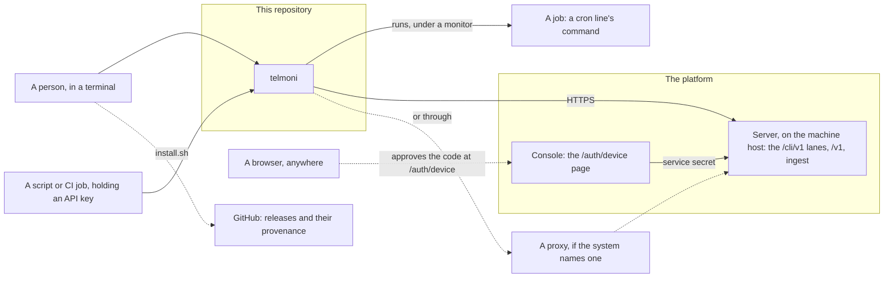
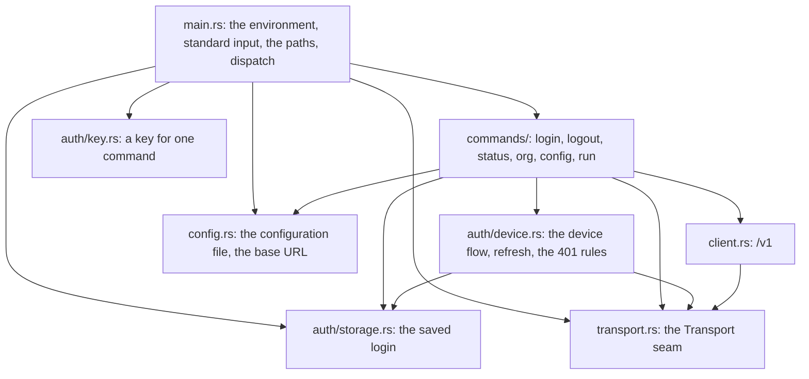

# Architecture

The Telmoni CLI on one page: what it is for, what it is made of, how a command reaches the platform, what it keeps, how it fails, and why it is built this way. It is the repository's one document on how the CLI is built: the detail behind each line is in the code it names, the code's comments and its tests.

The platform the CLI talks to has a design of its own, `ARCHITECTURE.md` in [`telmoni/telmoni`](https://github.com/telmoni/telmoni/blob/main/ARCHITECTURE.md), checked out beside this repo as `../telmoni/ARCHITECTURE.md`: its door for machines, the `/cli` lanes, `/me`, `/v1` and sessions. This page covers the client. The SDKs, which record an agent's runs and send them to the platform's ingest, are the platform's too, under `sdk/` in that repository, with their contract and parity table on its page (*The SDKs*).

**Where it stands:** version 0.1.0, on crates.io as `telmoni-cli`, and no release has been cut, so `install.sh` has nothing to fetch yet and the CLI is built from source with `cargo install`. It signs in and out, says who it is signed in as, chooses an organization, and runs a job under a monitor. Beyond its own session it changes nothing on the platform, except that `/cli/v1/me` makes a first organization for a person who belongs to none, as a console sign-in does, and that a run's first ping makes the monitor its slug names, paused as new, as the platform has every first ping do.

## Contents

- [Purpose and scope](#purpose-and-scope)
- [Goals and constraints](#goals-and-constraints)
- [Context](#context)
- [Building blocks](#building-blocks)
- [Key flows](#key-flows)
- [Data](#data)
- [Security](#security)
- [Distribution](#distribution)
- [When something fails](#when-something-fails)
- [What comes next](#what-comes-next)
- [Decisions](#decisions)
- [Known gaps](#known-gaps)

## Purpose and scope

The CLI, `telmoni`, is how a person or a machine uses Telmoni from a terminal. Today it:
- signs a person in with a code approved in any browser, or a machine in with an API key;
- says who it is signed in as, and in which organization;
- lists the person's organizations, and chooses the one it acts in;
- keeps a configuration file: the endpoint to sign in against;
- runs a command under a monitor: a ping at its start and at its end, under the project's ping key.

It is **one Rust binary**, a thin shell over a library the tests drive directly, and a **client of the platform and of nothing else**: nothing here runs on a server, holds a database or verifies a token.

| For | Read |
|---|---|
| Using the CLI | [telmoni.com/docs/api/cli](https://telmoni.com/docs/api/cli) |
| Developing it | `README.md`, `AGENTS.md`, and [Developing](https://telmoni.com/docs/contributing/developing#the-cli) |

## Goals and constraints

**What the design must hold:**

| Goal | How |
|---|---|
| **It talks to one platform, and to nothing else** | One base URL, `https://api.telmoni.com`, the machine host, unless `TELMONI_ENDPOINT` names another, and nothing in `src/` calls another host; plain HTTP only to a loopback endpoint; no redirect followed; the one page it opens unasked is the device page on that host or on the console beside it (`same_deployment` in `src/commands/login.rs`) |
| **It works where no browser can reach it** | The device flow: the person approves a code in any browser, on any machine, and nothing listens here |
| **A secret is never shown** | No token, refresh token, device code or API key in output or logs, and `Debug` written by hand on every struct that holds one |
| **An API key never rides a command line, and need not be saved** | `login --with-key` reads it from standard input; `TELMONI_API_KEY`, or what `api_key_helper` prints, supplies one for a single command and is never saved. A ping key may ride one (`run --ping-key`): it lives on crontab lines by design, and can fake a ping and nothing more |
| **A job is never failed by its monitor** | `run` keeps the command's streams and exit code as its own; a Telmoni that does not answer, or refuses a ping, is a note on stderr |
| **A crash or a blip never loses the session** | The saved login written atomically, to the Keychain or the file; a 5xx or a dropped connection never deletes it; a refresh whose answer was lost asked again once |
| **The platform decides when a session ends** | A 401 read by its problem type, one refresh deciding a bearer refused as expired or unknown |
| **What a checkout holds cannot redirect it** | The environment read only at the edge, a `.env` only in debug builds, and the configuration never from the working directory |
| **Tests never touch the network or the person's files** | HTTP, sleeps, the browser, standard input and both files' paths injected, and the Keychain left to the binary's own store, under an item named for its home |
| **A download can be checked** | A checksum beside every archive, and build provenance signed for the release workflow |

**What it is not, on purpose:**
- **A server, a database or a verifier.** The platform owns the session; the CLI holds its opaque tokens.
- **A loopback sign-in.** No listener, no redirect, no PKCE: a browser may never reach the machine.
- **Profiles.** One saved login, one session at a time.
- **A command written ahead of its lane.** A command waits for the platform to serve what it would call: `/v1`'s lanes in `V1_LANES`, `/cli`'s in auth's `cli_router`, both behind the server's door for machines.

**What it must live with:**
- **Nothing has shipped.** Commands, flags and both files change in place, with no migration of an older file and no deprecated alias (`AGENTS.md`).
- **The platform's code is the contract.** A disagreement is recorded, and reported there, never worked around here.
- **Two platforms are built:** Apple-silicon macOS and x86_64 Linux. On Intel macOS and ARM Linux, `install.sh` points to building from source, and it refuses any other platform.

## Context

Who and what the CLI talks to.

| Party | What it is to the CLI | What crosses |
|---|---|---|
| **A person** | Who signs in, at a terminal, over SSH or in a container | Commands; the user code and the URL on stdout |
| **A script or CI job** | Whoever holds an organization's API key | The key in `TELMONI_API_KEY` or from `api_key_helper` for each command, or saved once by `login --with-key`; then `/v1` reads |
| **A job** | The command `run` wraps: a cron job, a queue consumer, a script | Its standard streams, untouched, and its exit code, which the CLI exits with |
| **A browser, anywhere** | Where the person approves the code, on any machine | The console's `/auth/device` page; nothing reaches the CLI |
| **The platform's server** | The one host the CLI calls, `api.telmoni.com` on the hosted service: the `/cli/v1` lanes for a session, `/v1` for a key, `/ping/v1` for a run's start and its end under a ping key, behind the door that meters them by address and by credential | Every request, with the CLI's `User-Agent` and, when it acts in one, the organization's id |
| **The platform's console** | Where the person approves the code; the CLI never calls it, and opens its device page only when it is on the endpoint's own origin or stands beside the machine host | Nothing from the CLI; the page's address, printed |
| **A proxy** | Whatever the system's proxy variables name | Every request to another host, tunnelled through it and still encrypted; never one to this machine, which goes direct |
| **GitHub** | Where releases, their checksums and their provenance live | The archives, `SHA256SUMS`, `install.sh` |

## Building blocks

The binary's modules, in `src/`, each arrow one building or calling another; the types they share are left out. The last two rows of the table stand beside the binary.

| Block | What it is | What it keeps |
|---|---|---|
| `main.rs` | The only place that reads the environment and standard input: it resolves both files' paths, builds the transport, dispatches, and prints an error and exits 1 | — |
| `commands/` | One module per command, each handed its inputs as values | — |
| `auth/device.rs` | The device flow, refresh, and the reading of a 401 by its type | — |
| `auth/key.rs` | A key supplied for one command: `TELMONI_API_KEY`, else what `api_key_helper` prints, checked by its shape and never saved; and whether the variable's key is used, passed over, or asked about first | — |
| `auth/storage.rs` | The saved login: the macOS Keychain on a Mac, else the credentials file, read leniently and written atomically | The Keychain item `telmoni`, `credentials.json` |
| `config.rs` | The configuration file, the answers it keeps about `TELMONI_API_KEY`'s keys, and where the base URL comes from | `config.json` |
| `client.rs` | The one `/v1` call, under an API key | — |
| `transport.rs` | The seam every request goes through: TLS, deadlines, the plain-HTTP refusal, this machine past any proxy, the platform's error shapes | — |
| `xtask/` | The gate, `cargo xtask ci`, and packaging, `cargo xtask dist` | — |
| `install.sh` | The installer: the machine's archive, a version, the checksum | — |

## Key flows

### Signing in

`telmoni login` asks the server's `/cli/v1` lanes for a device code, prints the user code and the URL, and opens a browser only on a page of the deployment it signs in to: the endpoint's own origin, or the console beside a machine host. It polls at the interval the platform sets until the person approves or denies the code or it expires, then asks `/cli/v1/me` who signed in, and saves the login. `login --with-key` reads a key from standard input, never from a terminal, checks its shape and saves it, with no call.

### A key for one command

`status` with `TELMONI_API_KEY` set, or else with `api_key_helper` configured, asks `/v1` with that key, at the endpoint `TELMONI_ENDPOINT`, the configuration file or the default names, and neither reads nor writes the saved login. A blank variable is no variable. The helper runs through `sh` with nothing on its standard input and 30 seconds to answer; what it prints is the key, never shown, and its stderr is the person's. `login`, `logout` and `org`, which manage the saved login, say once that the variable outranks it, unless its key is still to be asked about or was declined.

At a terminal — standard input and standard error both one, and no `--json` — the variable's key is used only once the person said so, as Claude Code asks of `ANTHROPIC_API_KEY`: `status` asks on stderr, "TELMONI_API_KEY holds an API key. Use it ahead of the saved login? [y/N]", never showing the key or any part of it, and keeps the answer in `config.json` under `api_key_answers`, by the trimmed key's SHA-256, so a new key is asked about again; no answer at all, at the end of input, passes it over for that command alone. A key declined is passed over as if the variable were unset, the helper then standing in where one is configured, and `config set use_api_key_env true|false` answers for the key the variable holds now. Anywhere else — CI, a pipe, `--json` — the key is used unasked whatever was answered, as Claude Code uses its key under `-p`. The choice is `env_key_use` (`auth/key.rs`); the question, which reads standard input, is `main.rs`'s.

### A job under a monitor

`telmoni run --monitor <slug> -- <command>` pings the monitor's `/start` on the ping lane, under the key `--ping-key` or `TELMONI_PING_KEY` gives and at the endpoint a key asks at; runs the command with its own standard streams; then pings the slug for an exit code of `0`, or `/fail` with the code, and exits with it — `128` and the signal where one ended the command, `127` or `126` where it could not start, each reported as a failed run. Both pings name the run by an id drawn from the system's randomness, so one tried again is heard as the ping it repeats and two runs at once are told apart. A ping gets two tries, five seconds each and a second apart, and a refusal is final. Nothing Telmoni answers, or fails to, changes the command's course or its code: each failure is a `note: telmoni run:` line on stderr.

### A command that acts in an organization

`status` and `org switch` refresh the access token when it expires within a minute, then ask `/cli/v1/me` with the organization's id in `x-organization-id`, rewrite the cached person and organizations from the answer, and check that the platform acted in the organization they named. An organization is named by id or slug, resolved against the cache and sent as its id, and never by its label.

### Signing out

`telmoni logout` refreshes if it must, then revokes the session row through the `/cli` lane that ends one, the same revoke the console's Active sessions makes, falling back when the cached organization is one the person has left. It deletes the saved login, in the Keychain and the file, whatever the answer, and says so when the platform did not confirm.

### When the platform says no

A failed answer is read in the platform's three error shapes, and a 401 by its problem type. A 401 typed `unauthenticated` ends the session; `token-expired` or `invalid-token` on a call gets one refresh, whose answer decides; any other 401, a 5xx or a dropped connection ends nothing.

## Data

The CLI's state is two files in the person's configuration directory, `~/Library/Application Support/telmoni/` on macOS and `~/.config/telmoni/` on Linux, and never in the working directory; on a Mac, a Keychain item holds the login in the credentials file's place.

| File | Holds | Written |
|---|---|---|
| `credentials.json`, or on a Mac the Keychain item | The endpoint fixed at sign-in; for the device flow the access and refresh tokens, the access token's expiry, the session row's id, the person, the cached organizations and the active one; or an API key | At sign-in, after every refresh, and by `status` and `org switch`. On a Mac to the Keychain, as a generic password under the service `telmoni` with the file's path as its account, the file only while the Keychain refuses, as a locked one does over SSH and one that would put up a dialog does when stderr is no terminal; with both, the newer is read, and a save the Keychain takes deletes the file. Elsewhere the file, atomically, mode `0600`, not encrypted |
| `config.json` | The endpoint to sign in against, `api_key_helper`, a command that prints an API key, an output format no command reads yet, and `api_key_answers`: by each key's SHA-256, whether a person at a terminal chose to use the key `TELMONI_API_KEY` held | By `config set` and by `status`'s question, a plain write: it holds no secret, the helper's command and never its key, a key's digest and never the key |

A copy that cannot be read or parsed reads as signed out, or as the default configuration, with a note that never quotes it, and a missing one silently. The `config` commands alone fail on a `config.json` that does not parse.

## Security

- **One host.** Every request goes to the base URL, a redirect is answered as an error so a bearer never follows one, and the browser opens only on the endpoint's own origin or the console beside it.
- **TLS to every endpoint but a loopback one.** rustls with bundled web PKI roots, the same on every host; plain HTTP is refused before anything is sent unless the host is a loopback one, and a request to this machine never goes through a proxy.
- **Every request has a deadline**, 30 seconds in all and 10 to connect, so a stalled host fails in seconds rather than hanging.
- **No secret is printed.** No token, refresh token, device code or API key reaches stdout, stderr or `-v`'s log, the question about `TELMONI_API_KEY` names the variable and never its key, a key refused by its shape is named by where it came from, never by its value, saved credentials that do not parse are logged under `-v` by line and column, never by their contents, and a ping key is cut out of every address a log line or an error shows, by its place on the lane and by its shape (`transport::loggable_url`), as the platform cuts it from its own log.
- **An API key never rides a command line.** `login --with-key` reads standard input and refuses a terminal, so no key reaches `ps`, shell history or a CI log, and `TELMONI_API_KEY` is read once, at the edge, and never saved. A ping key may (`run --ping-key`): made for crontab lines, it can fake a ping and nothing more.
- **A checkout cannot steer a released binary.** A `.env` is read in debug builds only, and neither file is ever read from the working directory.
- **The supply chain is checked.** `--locked` on every gate step that resolves dependencies, `cargo deny` on every run and daily, `unsafe` forbidden, and every release's archives and installer attested for the release workflow.

## Distribution

- **The gate** is `cargo xtask ci`, the same locally and in CI, run in CI on both shipped platforms.
- **A release** is an annotated `v*` tag matching the workspace's version: each platform built natively, the archives and `install.sh` attested, and a GitHub release made from the tag.
- **`install.sh`** picks the archive for the machine, checks it against `SHA256SUMS`, and installs it. The checksum catches a corrupted download; the provenance, which `gh attestation verify` checks, catches a swapped one.

## When something fails

| Fails | What a person sees | What recovers it |
|---|---|---|
| **The platform, or the network** | The platform's message or, when nothing answered, the URL and the cause; the session kept | The platform |
| **The platform, or the network, under `run`** | A `note: telmoni run:` line on stderr; the command runs and exits as it would have. A start ping lost is a run of no duration; an end ping lost is a run the platform ends as never ended at the monitor's next run or its timeouts | The platform |
| **A refresh whose answer is lost** | Nothing: it is asked again once, within the platform's grace | — |
| **A slow or stalled host** | A timeout in seconds, never a hang | The host |
| **The session, ended in the console** | "session ended; run `telmoni login`", and the saved login deleted | `telmoni login` |
| **A 401 of another type** | Its message; the session kept | The platform |
| **A clock that runs slow** | Nothing: the refresh after the fact covers what the early one missed | — |
| **A crash mid-write** | The previous credentials file, whole | — |
| **A Keychain that would ask, over SSH or with stderr no terminal** | The login kept in the file instead, with a note; one saved in the Keychain unread, with a note | Unlocking it, the command at the Mac's own terminal, which may ask, or signing in again |
| **A failing `api_key_helper`** | Its stderr, then `api_key_helper failed`, printed nothing, or did not answer; no request | The helper, or `config set api_key_helper` |
| **A file that does not parse** | Signed out, or the default configuration, with a note; the `config` commands fail on it, and at a terminal the question about `TELMONI_API_KEY` comes back every time, its answer unkept | `telmoni login` for the credentials; mending or deleting `config.json` |
| **No configuration directory** | The command says so and exits 1 | The environment |
| **A browser that cannot open** | A note; the code and the URL are printed already | Any browser |
| **An organization's URL changed** | The new slug refused until the cache is rewritten; the old one held to the platform's answer by `status` and `org switch` | `telmoni status` |

## What comes next

- **A command that touches customer data** comes after its lane in the platform: `/cli` for a signed-in person, `/v1` for an API key (`AGENTS.md`).
- **A hook for a coding agent's session**, sent as a run, once the platform's ingest reads one out of what it would send ([the platform's design](https://github.com/telmoni/telmoni/blob/main/ARCHITECTURE.md#where-it-goes-next)).

## Decisions

| Decision | Why | What it gives up |
|---|---|---|
| **The device flow, not a loopback redirect** | The CLI runs over SSH, in containers and on hosts with no browser | The person types a code |
| **One base URL, the platform's machine host** | One address to configure, the same the SDKs send to, and the server answers the CLI straight, with no console in between | A self-hosted deployment routes its machine lanes by path or on a host of their own before the CLI can sign in |
| **The platform's opaque tokens, the platform deciding** | No token is verified here, so nothing here can be wrong about one | A request to learn whether a session lives |
| **A 401 read by its type, one refresh deciding** | A blip, a botched secret rotation or a proxy cannot sign every CLI out | The rules follow the platform's problem types, held in step by hand |
| **One retry of a refresh with no answer** | The platform rotates the refresh token on use, and a spent one presented late ends the session | A second request when the first answer was lost |
| **The login in the macOS Keychain on a Mac, else a `0600` file** | The Keychain encrypts it and asks before another program reads it; a container, a CI runner or a locked Keychain over SSH has none to ask, so the file, written atomically, stands in | On Linux, whoever can read the person's files can read the tokens; a Mac may ask again after the binary is replaced |
| **Keychain dialogs only when stderr is a terminal** | A dialog no one answers never returns, and a macOS CI runner has a screen with no one at it; at a terminal a person answers the unlock, or the dialog a replaced binary needs to read the item | Without a terminal, a dialog the Keychain would need is a refusal: the login goes to the file, and one a replaced binary would have to ask for reads as signed out |
| **A key for one command from `TELMONI_API_KEY` or a helper, ahead of the saved login** | A CI job or a secret manager needs no `login` and leaves no key on disk, as `GH_TOKEN` and `ANTHROPIC_API_KEY` work | A key in the environment reaches every process the shell starts |
| **`TELMONI_API_KEY` approved once a key, at a terminal** | A key left exported in a shell would otherwise stand in for the person's own login without a word; Claude Code asks once of `ANTHROPIC_API_KEY` for the same reason, and uses it unasked under `-p`, where nobody can answer. Kept by its SHA-256, so a new key is asked about again and the file holds no key | A `--json` run, or one with standard input or error redirected, uses a key the person declined; the file confirms a guessed key |
| **A blank variable is no variable** | An exported empty `TELMONI_API_KEY` would otherwise stand in for the saved login with no key at all; Anthropic's SDKs tell people to `unset` such a variable, and this needs no such rule | `TELMONI_API_KEY=""` cannot name an empty key |
| **`login --with-key` reads standard input, never an argument** | A key on the command line reaches `ps`, shell history and CI logs | A key typed at a terminal is refused: it is piped, or read from a file |
| **The environment at the edge, a `.env` in debug builds only** | A released binary run in somebody else's checkout cannot take its endpoint or key | A `.env` does nothing for a released binary |
| **Organizations by id or slug, never by label** | A label is neither unique nor stable, and a wrong guess acts in another organization | People type a slug, not a name; and a slug typed with a capital letter, which the console accepts, is unknown here |
| **No redirect followed, and plain HTTP only to a loopback endpoint** | A bearer must neither follow a redirect nor cross a network in the clear | A platform behind a redirect, or plain HTTP to another host, does not work |
| **This machine past any proxy** | A proxy would carry plain HTTP to this machine off it in the clear, and a remote one cannot reach its ports | A proxy set up to watch local traffic sees none of the CLI's |
| **rustls with bundled roots** | The same trust on every machine | A root added to the system's store is not trusted |
| **`Debug` written by hand wherever a secret lives** | A log line or a failing test prints no token, and a field added later must be placed | Each such struct carries its own `Debug` |
| **One gate, locally and in CI** | CI's Rust job is this same command, on both shipped platforms | The workflow lint is a CI job beside it, outside the gate |
| **Native builds, and provenance instead of a key** | Each archive is built on the platform it runs on, where CI's gate passed, and no signing key is kept anywhere: the certificate is minted per run | Two platforms; checking provenance needs `gh` |
| **`run` fails open** | A monitor exists to catch a job that did not run; a wrapper that stopped the job when Telmoni was down would cause what it watches for, and a monitor with a schedule turns the missing pings into *late* on its own | A wrong line is found in stderr, or by the monitor going late, never by the job failing |
| **Two tries a ping, five seconds each** | A lost end ping is a run the platform counts as never ended, a false alarm at the next run; the lane answers in milliseconds, and a job must not wait long on a Telmoni that does not | A ping behind a slow network is given up after eleven seconds |
| **A run id from `/dev/urandom`, no crate** | A ping tried again must be heard as the ping it repeats, and runs that overlap told apart; the CLI carries no `uuid` crate, and the standard library's randomness is not stable yet | A host without `/dev/urandom` sends pings that name no run |
| **The ping key on the command line too** | A ping key lives on crontab lines by design and can fake a ping and nothing more, where an API key reads a project | A process list shows it; `TELMONI_PING_KEY` keeps it out |
| **No signal relayed to the command** | Relaying needs `kill(2)`, a dependency the CLI does not carry; at a terminal, Ctrl-C reaches the command on its own | A SIGTERM to the wrapper alone leaves the command running and its run open until the platform ends it |

## Known gaps

The ones that shape the design, each kept here until it is closed:
- **Two CLI processes writing at once** are not locked against each other: the last rename wins.
- **Signing in again** leaves the earlier session live, under Active sessions, until it ends there.
- **`install.sh` checks the checksum, not the provenance**, since checking it needs `gh`.
- **`slow_down` grows the interval for good**, where the platform holds a poll to the interval it started with; harmless.
- **Some numbers are unnamed literals:** the 60-second refresh skew, the 5-second `slow_down` step and the 1-second interval floor.
- **`run` relays no signal:** one sent to the wrapper alone ends it and leaves the command running, its run open on the platform until the monitor's next run or its timeouts end it.
- **Untested:** the real transport's deadlines and connection failures, the direct client's lack of a proxy, the browser opening, a signed-in run of the binary, `run`'s pings against a live lane, and the question `status` asks at a terminal, since no test runs at one.
- **`output_format` is accepted and stored**, and no command reads it.
