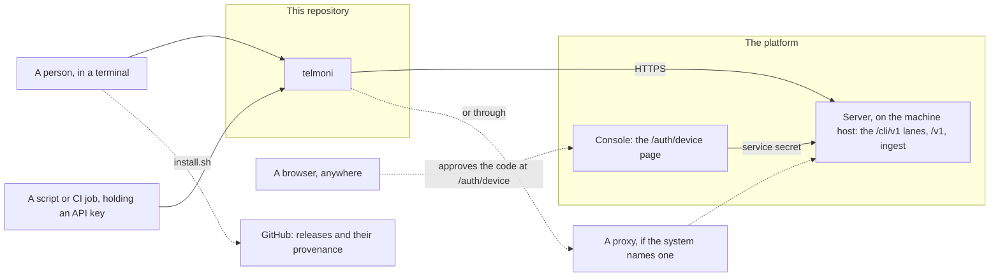
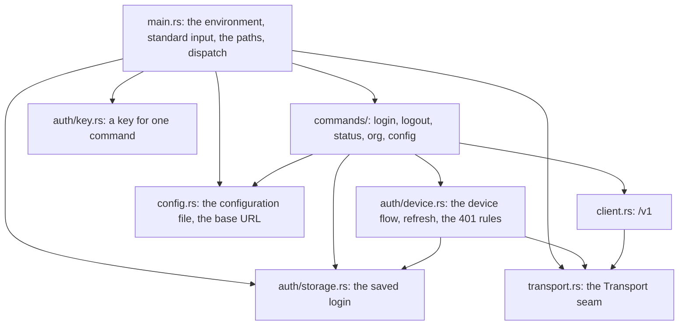

# Architecture

The Telmoni CLI on one page: what it is for, what it is made of, how a command reaches the platform, what it keeps, how it fails, and why it is built this way. It is the repository's one document on how the CLI is built: the detail behind each line is in the code it names, the code's comments and its tests.

The platform the CLI talks to has a design of its own, `ARCHITECTURE.md` in [`telmoni/telmoni`](https://github.com/telmoni/telmoni/blob/main/ARCHITECTURE.md), checked out beside this repo as `../telmoni/ARCHITECTURE.md`: its door for machines, the `/cli` lanes, `/me`, `/v1` and sessions. This page covers the client. The SDKs, which record an agent's runs and send them to the platform's ingest, are the platform's too, under `sdk/` in that repository, with their contract and parity table on its page (*The SDKs*).

**Where it stands:** version 0.2.0, released from CI on 23 October 2026 to GitHub, whose archive `install.sh` fetches on x86_64 Linux, and to crates.io as `telmoni-cli`, which every other platform builds from source with `cargo install`; `v0.1.1`, the first release from CI, reached GitHub alone (*A release*). It signs in and out, says who it is signed in as, and chooses an organization. Beyond its own session it changes nothing on the platform, except that `/cli/v1/me` makes a first organization for a person who belongs to none, as a console sign-in does.

## Contents

- [Purpose and scope](#purpose-and-scope)
- [Goals and constraints](#goals-and-constraints)
- [Context](#context)
- [Building blocks](#building-blocks)
- [Commands and their lanes](#commands-and-their-lanes)
- [Key flows](#key-flows)
- [Configuration](#configuration)
- [Data](#data)
- [Output and exit codes](#output-and-exit-codes)
- [The transport](#the-transport)
- [Reading the platform's errors](#reading-the-platforms-errors)
- [Security](#security)
- [Testing](#testing)
- [Distribution](#distribution)
- [When something fails](#when-something-fails)
- [What comes next](#what-comes-next)
- [Decisions](#decisions)
- [Known gaps](#known-gaps)

## Purpose and scope

The CLI, `telmoni`, is how a person or a machine uses Telmoni from a terminal. Today it:
- signs a person in with a code approved in any browser, or a machine in with an API key;
- says who it is signed in as, and in which organization;
- lists the person's organizations, and chooses the one it acts in;
- keeps a configuration file: the endpoint to sign in against, a command that prints an API key, and the answers a person gave about the key in `TELMONI_API_KEY`.

It is **one Rust binary**, a thin shell over a library the tests drive directly, and a **client of the platform and of nothing else**: nothing here runs on a server, holds a database or verifies a token.

| For | Read |
|---|---|
| Using the CLI | [`web/content/docs/api/cli.mdx`](https://github.com/telmoni/telmoni/blob/main/web/content/docs/api/cli.mdx) in `telmoni/telmoni` |
| Developing it | `README.md`, `AGENTS.md`, and [Developing](https://github.com/telmoni/telmoni/blob/main/web/content/docs/contributing/developing.mdx#the-cli) |

## Goals and constraints

**What the design must hold:**

| Goal | How |
|---|---|
| **It talks to one platform, and to nothing else** | One base URL, the machine host of the self-hosted deployment `login --endpoint`, `TELMONI_ENDPOINT` or `config.json` names, with no default, so an unconfigured CLI calls nothing, and nothing in `src/` calls another host; plain HTTP only to a loopback endpoint; no redirect followed; the one page it opens unasked is the device page on that host or on the console beside it (`same_deployment` in `src/commands/login.rs`) |
| **It works where no browser can reach it** | The device flow: the person approves a code in any browser, on any machine, and nothing listens here |
| **A secret is never shown** | No token, refresh token, device code or API key in output or logs, and `Debug` written by hand on every struct that holds one |
| **A key never rides a command line, and need not be saved** | `login --with-key` reads it from standard input; `TELMONI_API_KEY`, or what `api_key_helper` prints, supplies one for a single command and is never saved |
| **A crash or a blip never loses the session** | The saved login written atomically, to the Keychain or the file; a 5xx or a dropped connection never deletes it; a refresh whose answer was lost asked again once |
| **The platform decides when a session ends** | A 401 read by its problem type, one refresh deciding a bearer refused as expired or unknown |
| **What a checkout holds cannot redirect it** | The environment read only at the edge, a `.env` only in debug builds, and the configuration never resolved against the working directory |
| **Tests never touch the network or the person's files** | HTTP, sleeps, the browser, standard input and both files' paths injected, and the Keychain left to the binary's own store, under an item named for its path |
| **A download can be checked** | A checksum beside every archive, and build provenance signed for the release workflow |

**What it is not, on purpose:**
- **A server, a database or a verifier.** The platform owns the session; the CLI holds its opaque tokens.
- **A loopback sign-in.** No listener, no redirect, no PKCE: a browser may never reach the machine.
- **Profiles.** No profile names and no switch between them: a login lives in a configuration directory, one session at a time, and `TELMONI_CONFIG_DIR` names another.
- **A command written ahead of its lane.** A command waits for the platform to serve what it would call: `/v1`'s lanes in `V1_LANES`, `/cli`'s in auth's `cli_router`, both behind the server's door for machines.

**What it must live with:**
- **Nothing has shipped.** Commands, flags and both files change in place, with no migration of an older file and no deprecated alias (`AGENTS.md`).
- **The platform's code is the contract.** A disagreement is recorded, and reported there, never worked around here.
- **One platform is released, until the macOS build is signed:** x86_64 Linux. On a Mac, Apple silicon or Intel, and on ARM Linux, `install.sh` points to building from source, and it refuses any other platform. The macOS archive waits until it can be hardened and signed, since an unsigned one would ask for the Keychain at every upgrade; CI's gate still builds and tests on Apple silicon at every push.

## Context

Who and what the CLI talks to.

| Party | What it is to the CLI | What crosses |
|---|---|---|
| **A person** | Who signs in, at a terminal, over SSH or in a container | Commands; the user code and the URL on stdout |
| **A script or CI job** | Whoever holds an organization's API key | The key in `TELMONI_API_KEY` or from `api_key_helper` for each command, or saved once by `login --with-key`; then `/v1` reads |
| **A browser, anywhere** | Where the person approves the code, on any machine | The console's `/auth/device` page; nothing reaches the CLI |
| **The platform's server** | The one host the CLI calls, the deployment the endpoint names: the `/cli/v1` lanes for a session, `/v1` for a key, behind the door that meters them by address and by credential | Every request, with the CLI's `User-Agent` and, when it acts in one, the organization's id |
| **The platform's console** | Where the person approves the code; the CLI never calls it, and opens its device page only when it is on the endpoint's own origin or stands beside the machine host | Nothing from the CLI; the page's address, printed |
| **A proxy** | Whatever the system's proxy variables name | Every request to another host, tunnelled through it and still encrypted; never one to this machine, which goes direct |
| **GitHub** | Where releases, their checksums and their provenance live | The archives, `SHA256SUMS`, `install.sh` |

## Building blocks

The binary's modules, in `src/`, each arrow one building or calling another; the types they share are left out. The last two rows of the table stand beside the binary.

| Block | What it is | What it keeps |
|---|---|---|
| `main.rs` | The only place that reads the environment and standard input, beside clap's `env` on `login --endpoint`: it sets up `tracing` on stderr, resolves both files' paths, builds the transport, asks the question about `TELMONI_API_KEY`, reads a piped key (`read_piped_key`), dispatches, and prints an error and exits 1, or 4 when no login is usable | — |
| `lib.rs` | The library the binary and the suites share, `unsafe` forbidden | — |
| `commands/login.rs` | The device flow end to end, `--with-key`, the shape check of a key (`validate_api_key`), and which page may open unasked (`same_deployment`) | — |
| `commands/logout.rs` | Ending the session on the platform (`end_session`), the revoke's organization and its fallbacks, then deleting the saved login | — |
| `commands/status.rs` | `status` and `whoami`, for a device session, a saved key or a key supplied for the command, in text or `--json`, and the saved login a supplied key passed over (`UnusedLogin`) | — |
| `commands/org.rs` | `org list` from the cache, `org switch` held to `/cli/v1/me`'s answer, and the "Active organization" line three commands print | — |
| `commands/config_cmd.rs` | `config get`, `set` and `list` | — |
| `auth/device.rs` | The device start and poll, the backoff loop (`poll_until_granted`), `/cli/v1/me`, refresh and revoke, and the reading of a 401 by its type (`refused_credentials`, `bearer_expired`); the two errors that exit 4, `SessionEnded` and `NotSignedIn` | — |
| `auth/key.rs` | A key supplied for one command: `TELMONI_API_KEY`, else what `api_key_helper` prints, checked by its shape and never saved; and whether the variable's key is used, passed over, or asked about first | — |
| `auth/storage.rs` | The saved login, a device session or a saved key, one enum tagged by the file's `auth_type`: the macOS Keychain on a Mac, else the credentials file, read leniently and written atomically by `write_replacing`, which `config.json` shares | The Keychain item `telmoni`, `credentials.json` |
| `config.rs` | The configuration file, the answers it keeps about `TELMONI_API_KEY`'s keys, and where the base URL comes from | `config.json` |
| `client.rs` | The one `/v1` call, under an API key | — |
| `transport.rs` | The seam every request goes through: TLS, deadlines, the plain-HTTP refusal, this machine past any proxy, the platform's error shapes; `LaneRequest::to` builds each request and `expect_json` reads each answer, so every refusal reaches the caller as the `LaneError` it is | — |
| `xtask/` | The gate, `cargo xtask ci`, and packaging, `cargo xtask dist` | — |
| `install.sh` | The installer: the machine's archive, the latest tag read from the release page's redirect or a version, the checksum | — |

## Commands and their lanes

Every command, what it sends and in what order. Global to all: `-v`/`--verbose`, and clap's `--help` and `--version`. "Refresh when expiring" is `POST /cli/v1/auth/refresh` with `{ refreshToken, sessionRowId }`, sent first when the access token is within `REFRESH_SKEW_SECS` (60) of its expiry (`auth/storage.rs`); the `/cli/v1/me` of `status` and `org switch`, and `logout`'s revoke, also get one refresh and one retry when its bearer is refused as expired or unknown (*Reading the platform's errors*).

| Command | Its flags and arguments | What it calls | What it changes here |
|---|---|---|---|
| `login` | `--endpoint <url>`, filled from `TELMONI_ENDPOINT` too; `--no-browser` | `POST /cli/v1/auth/device`; `POST /cli/v1/auth/device/poll` with `{ deviceCode }` every interval; `POST /cli/v1/me` under the new bearer, naming no organization, asked once more if it gets no answer | Saves the device session |
| `login --with-key` | Conflicts with `--no-browser`; `--endpoint` as above | Nothing: the key is checked by its shape alone | Saves the key, read from standard input (at most 4096 bytes; a terminal refused) |
| `logout` | — | A device session: refresh when expiring; `POST /cli/v1/sessions/{sessionRowId}/revoke` with `x-organization-id` the one `TELMONI_ORG` names, else the active one, else the first cached, none when the cache holds none; on a 403 to one that named an organization, again naming none; on a 400, `POST /cli/v1/me` naming none, then the revoke naming its active organization. A saved key: nothing | Deletes the saved login whatever the answer; signed out already, prints "Not signed in" and exits 0 |
| `status`, `whoami` | `--json` | A key supplied for the command, or a saved one: `GET /v1/organization` under it. A device session: refresh when expiring, then `POST /cli/v1/me` with `x-organization-id` the one `TELMONI_ORG` names, else the active one. Signed out: nothing | A device session's cached person and organizations, rewritten from the answer |
| `org list` | — | Nothing: the cached list, the active one marked `*` | — |
| `org switch <ORGANIZATION>` | An id (`org_…`) or an exact slug, resolved against the cache | Refresh when expiring, then `POST /cli/v1/me` with the target's id | The cached list, always; the active organization, only when the answer acts in the target and its list still gives it that name |
| `config get <key>`, `config set <key> <value>`, `config list` | Keys `endpoint`, `output_format`, `api_key_helper`, `use_api_key_env` (`ConfigKey` in `config.rs`) | Nothing | `config.json` |

`org` refuses a saved API key as it refuses no login, exit 4: its lanes are a person's. `login`, `logout` and `org` never act with `TELMONI_API_KEY` or the helper; only `status` and `whoami` do.

## Key flows

### Signing in

`telmoni login` asks the server's `/cli/v1` lanes for a device code, prints the user code and the URL, and opens a browser only on a page of the deployment it signs in to: the endpoint's own origin, or the console beside a machine host. It polls at the interval the platform sets until the person approves or denies the code or it expires, then asks `/cli/v1/me` who signed in, and saves the login. The loop is `poll_until_granted` (`auth/device.rs`), its sleep and clock passed in: it waits an interval before every poll, never less than a second (`login.rs`), checks the code's lifetime on its own clock before each, and reads each answer as `PollOutcome`:

| Answer | Outcome | Then |
|---|---|---|
| 200 | `Granted` | The tokens, then `/cli/v1/me` |
| 202 | `Pending`, or `SlowDown` when its body says `"status": "slow_down"` | The same interval, or 5 seconds more from then on |
| 429 | `RateLimited` | One wait of the problem's `retry_after_secs` or the interval, whichever is longer |
| No answer, or a 5xx | `Unanswered` | The interval doubled, at most `MAX_POLL_INTERVAL` (60 s), as RFC 8628 § 3.5 asks |
| 401 typed `invalid-token` | `Failed` | "the device code is no longer valid; run telmoni login again" |
| Any other: 403 denied, 400 expired | `Failed` | The platform's message |

`login --with-key` reads a key from standard input, never from a terminal, checks its shape and saves it, with no call.

### A key for one command

`status` with `TELMONI_API_KEY` set, or else with `api_key_helper` configured, asks `/v1` with that key, at the endpoint `TELMONI_ENDPOINT` or the configuration file names (with neither, it fails as `login` does), and never writes the saved login; it reads it only to name it after the report as not in use (`Saved login, not in use: a device sign-in for <email>`, or `a saved API key`; `--json`: `unusedLogin`, `device` or `api_key`, absent when there is none), through `CredentialsStore::peek`, which reads as `load` does, the Keychain asked, and prints none of the store's notes. A blank variable is no variable. The helper runs through `sh` with nothing on its standard input and 30 seconds to answer; what it prints is the key, never shown, and its stderr is the person's. `login`, `logout` and `org`, which manage the saved login, say once that the variable outranks it, unless its key is still to be asked about or was declined.

At a terminal — standard input and standard error both one, and no `--json` — the variable's key is used only once the person said so: `status` asks on stderr, "TELMONI_API_KEY holds an API key. Use it ahead of the saved login? [y/N]", never showing the key or any part of it, and keeps the answer in `config.json` under `api_key_answers`, by the trimmed key's SHA-256, so a new key is asked about again; no answer at all, at the end of input, passes it over for that command alone. A key declined is passed over as if the variable were unset, with a note on stderr each time naming the way back, the helper then standing in where one is configured, and `config set use_api_key_env true|false` answers for the key the variable holds now. Anywhere else — CI, a pipe, `--json` — the key is used unasked whatever was answered. The choice is `env_key_use` (`auth/key.rs`); the question, which reads standard input, is `main.rs`'s.

### A command that acts in an organization

`status` and `org switch` refresh the access token when it expires within a minute, then ask `/cli/v1/me` with the organization's id in `x-organization-id`, rewrite the cached person and organizations from the answer, and check that the platform acted in the organization they named. An organization is named by id or slug, resolved against the cache and sent as its id, and never by its label.

### Signing out

`telmoni logout` refreshes if it must, then revokes the session row through the `/cli` lane that ends one, the same revoke the console's Active sessions makes, falling back when the cached organization is one the person has left. It deletes the saved login, in the Keychain and the file, whatever the answer, and says so when the platform did not confirm.

### Refreshing

The platform's access token is opaque and lives minutes; the refresh token rotates on every use. A refresh is asked for early, within `REFRESH_SKEW_SECS` of the expiry the file keeps, or late, once, when a bearer is refused as `token-expired` or `invalid-token`. `refresh_session` (`auth/device.rs`) sends it, and when the answer is lost, a 5xx or nothing to read, sends the same token again at once: the platform may have spent it, and takes it again only within its reuse grace, thirty seconds (`REUSE_GRACE_SECS` in the core's `crates/auth/src/db/refresh_tokens.rs`). The new pair is saved before anything else is sent; an answer without a refresh token leaves none, so the next refresh ends the session. A refresh refused by a 401 of any of the three types below ends it now, `token-expired` included: on that lane it is the refresh token that is refused.

### When the platform says no

A failed answer is read in the platform's three error shapes, and a 401 by its problem type (*Reading the platform's errors*). A 401 typed `unauthenticated` ends the session; `token-expired` or `invalid-token` on a call gets one refresh, whose answer decides; any other 401, a 5xx or a dropped connection ends nothing.

## Configuration

Every input the CLI reads, and which wins. The environment is read once, in `main.rs`, and passed down as values; a variable that is blank, or only spaces, is no variable.

| Input | What it sets | Read by |
|---|---|---|
| `TELMONI_ENDPOINT` | The base URL a command without a saved login talks to | `main.rs`, and clap's `env` on `login --endpoint` |
| `TELMONI_API_KEY` | A key for `status` and `whoami`, ahead of the saved login, never saved (*A key for one command*) | `main.rs` |
| `TELMONI_ORG` | The organization `status` and `logout` act in for this command, by id or exact slug from the cached list; never saved as the active one | `main.rs` |
| `TELMONI_CONFIG_DIR` | The directory both files live in, trimmed; an absolute path alone, a relative one exits 1 | `main.rs` |
| `.env` in the working directory | The four variables above, after the real environment; debug builds only, compiled out of a release (`dotenv_var`) | `main.rs` |
| `HOME`, and on Linux `XDG_CONFIG_HOME` | The configuration directory when `TELMONI_CONFIG_DIR` is unset | `dirs::config_dir` |
| `HTTPS_PROXY`, `HTTP_PROXY`, `ALL_PROXY`, `NO_PROXY`, and their lowercase forms | A proxy for every host but this machine | reqwest |
| `config.json` | `endpoint`, `output_format`, `api_key_helper`, `api_key_answers` (*Data*) | `config.rs` |
| Flags | `-v`, `login --endpoint`, `--with-key`, `--no-browser`, `status --json` (*Commands and their lanes*) | clap |

`RUST_LOG` is not read: `-v` is the one switch for the log.

**The endpoint**, for a command with no saved login to use (`login`, a signed-out `status`, `status` under a supplied key): `--endpoint`, then `TELMONI_ENDPOINT`, then `config.json`'s `endpoint` (`resolve_endpoint` in `config.rs`, which logs its source under `-v`). There is no default: Telmoni is self-hosted, so with none of them `login` and `status` under a key fail, naming the three, and a signed-out `status` prints no endpoint line. Each is trimmed of spaces and trailing slashes, and one without a scheme takes `http://` for a loopback host and `https://` for any other; a blank one is skipped. A saved login carries the endpoint it was made against, and every later command on it goes there, whatever the environment says.

**The key `status` acts with:** `TELMONI_API_KEY`, as the person at a terminal answered for it, then the output of `api_key_helper`, then the saved login.

**The organization:** `TELMONI_ORG`, then the active organization the saved login holds; for `logout`'s revoke, then the first cached.

**The directory:** `TELMONI_CONFIG_DIR`, then `dirs::config_dir()` joined with `telmoni`; with neither, the command says so and exits 1.

## Data

The CLI's state is two files in one directory: the person's configuration directory, `~/Library/Application Support/telmoni/` on macOS and `~/.config/telmoni/` on Linux (`$XDG_CONFIG_HOME/telmoni/` when that is set), or the one `TELMONI_CONFIG_DIR` names, an absolute path, so a shell with a value of its own keeps a login of its own; never one resolved against the working directory, so a relative path is refused. On a Mac, a Keychain item holds the login in the credentials file's place, its account the file's path as given, so each directory's login is an item of its own.

| File | Holds | Written |
|---|---|---|
| `credentials.json`, or on a Mac the Keychain item | The endpoint fixed at sign-in; for the device flow the access and refresh tokens, the access token's expiry, the session row's id, the person, the cached organizations and the active one; or an API key | At sign-in, after every refresh, and by `status` and `org switch`. On a Mac to the Keychain, as a generic password under the service `telmoni` with the file's path as its account, the file only while the Keychain refuses, as a locked one does over SSH and one that would put up a dialog does when stderr is no terminal; with both, the newer is read, and a save the Keychain takes deletes the file. Elsewhere the file, atomically, mode `0600`, not encrypted |
| `config.json` | The endpoint to sign in against, `api_key_helper`, a command that prints an API key, an output format no command reads yet, and `api_key_answers`: by each key's SHA-256, whether a person at a terminal chose to use the key `TELMONI_API_KEY` held | By `config set` and by `status`'s question, atomically like the credentials, so a crash cannot leave a torn file that reads as no endpoint, under the umask's mode: it holds no secret, the helper's command and never its key (`config set api_key_helper` refuses a value carrying one), a key's digest and never the key |

A copy that cannot be read or parsed reads as signed out, or as the default configuration, with a note that never quotes it, and a missing one silently. The `config` commands alone fail on a `config.json` that does not parse.

## Output and exit codes

Stdout carries the command's output and nothing else; notes, the question about `TELMONI_API_KEY`, "Waiting for approval…" and every error go to stderr, and so does `-v`'s log (`tracing`, the CLI's own lines at `debug` and other crates' at `info`; without `-v`, its own at `info` and the rest at `warn`; no timestamps, colour only when stderr is a terminal).

**Text** is the one format of every command but `status`, written for a person and free to change. `login` prints the user code and the URL on stdout. **`status --json`** (and `whoami --json`) prints one pretty JSON object, camelCase, and on a failure nothing on stdout at all:
- a device session: `authType` `"device"`, `endpoint`, `person` (`userId`, `email`, `displayName`), `activeOrganization` (`organizationId`, `slug`, `label`, `role`, or `null`), `organizationCount`, `tokenExpiresInSecs`;
- a key: `authType` `"api_key"`, `keySource` (`saved`, `environment` or `helper`), `endpoint`, `organization` (`organizationId`, `slug`, `label`), and `unusedLogin` (`device` or `api_key`) only when a supplied key passed a saved login over.

Every `endpoint` shown passes through `loggable_url`. `output_format` in `config.json` is stored and read by nothing.

| Exit | When |
|---|---|
| 0 | The command did what it says, `logout` with nothing to sign out of included |
| 1 | Any other error, its one line on stderr: the platform's message, a request with no answer, a file step, a refused value, a relative `TELMONI_CONFIG_DIR`, no configuration directory |
| 2 | clap's own: an unknown command, flag or value |
| 4 | No usable login: `SessionEnded` (the platform ended it, or nothing is left to renew it with; the saved login is gone) or `NotSignedIn` (`status` with no login and no key, `org` with none or with a saved key), so a script signs in again rather than retrying |

## The transport

Every request goes through `Transport::send` (`transport.rs`), one trait the suites replace; `ReqwestTransport` is the real one.

- **Two clients, one builder** (`client_builder`): one through any proxy the environment names, one with none for this machine (`bypasses_proxy`), identical in all else.
- **Deadlines:** `REQUEST_TIMEOUT`, 30 seconds from connecting to the answer's last byte, and `CONNECT_TIMEOUT`, 10 seconds of that to connect.
- **No redirect followed** (`Policy::none()`): no lane answers one, and reqwest would carry the bearer to a same-host target on another scheme. A 3xx is read as the error it is.
- **TLS** is rustls with the bundled web PKI roots (reqwest's `rustls-tls`, default features off), so trust is the same on every machine and the system's store is not read; HTTP/1.1 alone, since `http2` is off with the defaults.
- **Plain HTTP only to this machine** (`refuse_cleartext`, before any socket): `localhost`, a name under `.localhost`, or a loopback address, read from the parsed URL (`is_loopback_host`), so `localhost.example.com` is not one. The device start is refused like the rest, though it carries no credential, since it is answered one.
- **Every request** carries `User-Agent: telmoni-cli/<version> (<os>; <arch>)` (`build_user_agent`), `Authorization: Bearer` when it acts with a token or key, `x-organization-id` when it names an organization, and a JSON body when it has one. `LaneRequest::to` builds the URL from the endpoint and the lane's path.
- **Retries** are the lanes' own, never the transport's: the device poll (*Signing in*), one more refresh and one more sign-in `/cli/v1/me` when the answer is lost, and the one refresh-and-retry after a refused bearer. Nothing else is sent twice: a 429 or a 5xx on any other call is the error it carries.
- **`Retry-After`** is read from the problem body's `retry_after_secs`, the extension the platform also sends as the header (`RETRY_AFTER_SECS` in the core's `crates/shared/src/error_schema.rs`), not from the header; only the device poll waits on it.
- **A request that got no answer** is one line naming the address and the cause at the bottom of the error chain (`request_failed`), so a refused connection, a name that does not resolve and a certificate that does not verify read apart; a timeout is "timed out waiting for <url>".

## Reading the platform's errors

`parse_lane_error` (`transport.rs`) reads any answer it was not expecting in one of three shapes, and `expect_json` hands it to the caller as a `LaneError` (status, problem type, message, `retry_after_secs`):

| Shape | Recognised by | Message |
|---|---|---|
| RFC 9457 problem details | A JSON body with string `type` and `title` | `title: detail`, or the title alone when there is no detail |
| `{ "error": … }` | A JSON body with a string `error` | That string; nothing the CLI calls sends it today |
| Anything else | — | `request failed (<status>)` and the body's first 200 characters |

A 401 is then read by its type (`refused_credentials` in `auth/device.rs`), and only auth's own three mean anything:

| Type | On `/cli/v1/me` or a revoke | On `/cli/v1/auth/refresh` |
|---|---|---|
| `/errors/auth/token-expired` | One refresh and one retry | The session ends |
| `/errors/auth/invalid-token` | One refresh and one retry: an expired bearer is unknown once the platform's retention sweep has deleted its row | The session ends |
| `/errors/auth/unauthenticated` | The session ends | The session ends |
| Any other, `service-credential-rejected` or no type at all | Its message; nothing ends | Its message; nothing ends |

The session ending is `SessionEnded`: the saved login deleted, in the Keychain and the file, "session ended; run telmoni login", exit 4. A 5xx or no answer never deletes it. On a revoke, a 204 is done and a 404 typed `/errors/auth/not-found` is done already; the server's own untyped 404 is not. `logout` takes a revoke refused as a session already over, or refused again after a fresh refresh, as confirmed; anything else it reports as unconfirmed and signs out here regardless. A 401 under an API key on `/v1` is its message, and leaves the saved login alone.

## Security

What the design defends against, and what it leaves to the machine:

| Threat | Defence |
|---|---|
| **A network between the CLI and the platform** | TLS to every host but this machine, no redirect followed, and a proxy never handed loopback traffic |
| **A checkout the CLI runs in** (a `.env`, a `config.json` naming its own endpoint) | A `.env` read by debug builds alone, and no path resolved against the working directory |
| **An answer that names another host** (a verification URL elsewhere) | The URL printed, and opened only when `same_deployment` holds |
| **Other users on the machine** | The credentials file created `0600` from the start, a directory made for it `0700` (`write_replacing`), and on a Mac the Keychain |
| **Logs, CI output, `ps` and shell history** | No secret printed or logged, `Debug` by hand, no key as an argument |
| **A key left exported in a shell** | Asked about once at a terminal before it stands in for the person's own login |

Out of reach, on purpose: a program running as the same user, which can read the credentials file on Linux and ask for the Keychain item on a Mac; root; and a platform that is itself compromised, whose answers the CLI trusts as the one authority on the session.

- **One host.** Every request goes to the base URL, a redirect is answered as an error so a bearer never follows one, and the browser opens only on the endpoint's own origin or the console beside it.
- **TLS to every endpoint but a loopback one.** rustls with bundled web PKI roots, the same on every host; plain HTTP is refused before anything is sent unless the host is a loopback one, and a request to this machine never goes through a proxy.
- **Every request has a deadline**, 30 seconds in all and 10 to connect, so a stalled host fails in seconds rather than hanging.
- **No secret is printed.** No token, refresh token, device code or API key reaches stdout, stderr or `-v`'s log, the question about `TELMONI_API_KEY` names the variable and never its key, a key refused by its shape is named by where it came from, never by its value, saved credentials that do not parse are logged under `-v` by line and column, never by their contents, and an address a log line or an error shows is rebuilt without any credentials written into it and with every segment carrying an API key's prefix cut out (`transport::loggable_url`), as the platform cuts one from its own log.
- **A key never rides a command line.** `login --with-key` reads standard input and refuses a terminal, so no key reaches `ps`, shell history or a CI log, and `TELMONI_API_KEY` is read once, at the edge, and never saved.
- **A checkout cannot steer a released binary.** A `.env` is read in debug builds only, and neither file is ever read relative to the working directory: `TELMONI_CONFIG_DIR` takes an absolute path alone.
- **A key is never written where a command is meant to be.** `config set api_key_helper` refuses a value with a word that looks like a key, `tm_` and at least 32 URL-safe characters after it (`holds_a_key` in `config.rs`), and the answers about `TELMONI_API_KEY` are kept by digest. The helper's stdout is the key and is never shown; its stderr is the person's, its standard input empty, and it is killed after `HELPER_TIMEOUT`, 30 seconds (`auth/key.rs`).
- **The supply chain is checked.** `--locked` on every gate step that resolves dependencies, `cargo deny` on every run and daily, `unsafe` forbidden, and every release's archives and installer attested for the release workflow.

## Testing

Every suite is hermetic: no network, no sleeps, no person's files or Keychain. Each runs under `cargo xtask ci`'s `cargo test --workspace --locked`.

| Suite | Drives | What it proves |
|---|---|---|
| `tests/auth_tests.rs` | The library, through a `MockTransport` that answers from a queue, records every request and fails a test that sends more than any should; credentials under `std::env::temp_dir()` through `CredentialsStore::new`, the file alone; the poll's sleep and clock passed in, every wait asserted | The platform's own answers decode (`tests/fixtures/me.json` and `authn.json`, copies of the core's `contract/responses/auth/`); the poll's outcomes and backoff; refresh, its retry when unanswered, and the spent token; every 401 rule on `/me`, a refresh and a revoke, and that a 5xx or no answer keeps the login; logout's organization fallbacks; `org switch` and `TELMONI_ORG` by id or slug, never by label, held to the answer; the endpoint's precedence; the key's shape, the helper, and the question about the variable's key; the files private and atomic; the plain-HTTP refusal, the proxy bypass and `loggable_url`; `Debug` never printing a secret |
| `tests/cli_tests.rs` | The built binary (`CARGO_BIN_EXE_telmoni`), in a home and working directory of its own, its environment cleared to that home and what the test sets | What `main.rs` reads and where its files land: the signed-out `status` and its exit 4, the configuration file and the environment over it, `.env` in a debug build alone, `login --with-key` and `logout` without a request, a key for one command and unasked use where nobody can answer, a login per `TELMONI_CONFIG_DIR`; no secret on either stream. A command that would reach a host points at a plain-HTTP remote one, refused before any socket |
| `src/commands/login.rs` | `same_deployment` | The console beside a machine host opens; another host, scheme or port does not |

On a Mac the binary's suite reads and writes Keychain items named for its sandbox's paths, never a person's. Untested: see *Known gaps*.

## Distribution

- **The gate** is `cargo xtask ci` (`xtask/src/main.rs`), the same locally and in CI: `cargo fmt --all --check`; the toolchain channel in `rust-toolchain.toml` (1.99.1) equal to `rust-version` in `Cargo.toml`; clippy over every target with `-D warnings`; build, test and doc, each with warnings denied; then `cargo deny --locked check` (`deny.toml`: licences, advisories, bans and sources, for `x86_64-unknown-linux-gnu` and `aarch64-apple-darwin`). Every step but fmt is `--locked`. The workspace's lints (`Cargo.toml`) deny `unwrap`, `expect`, `panic`, indexing and string slicing outside tests (`clippy.toml` allows them in tests), and `unsafe` everywhere.
- **CI** (`.github/workflows/ci.yml`), on every push to `main` and every pull request: the gate on `ubuntu-24.04` (linux-x86_64) and `macos-15` (macos-aarch64), with `cargo-deny` installed for it; `actionlint`, pinned by version and checksum, over the workflows; and one `CI status` job that passes only when both did. `audit.yml` runs `cargo deny check advisories` against the pinned lock daily at 05:30 UTC, and Dependabot proposes the actions' updates weekly, a week after each is out.
- **A release** is the workspace's version bumped in one commit on `main`. Its push starts `.github/workflows/release.yml`, which waits for CI to pass on that commit, since crates.io's trusted publishing refuses a run that CI's `workflow_run` starts, then builds the static x86_64 Linux archive, the binary with `LICENSE`, `NOTICE` and `THIRD_PARTY_LICENSES.txt` beside it, the last written by `cargo-about` (`about.toml`, `about.hbs`) from the linked crates, and verifies the crate, and waits for the owner's approval in its `release` environment: one job tags the commit `v*`, attests the archive and `install.sh` and makes the GitHub release, and another publishes the crate to crates.io by trusted publishing, so no token is stored anywhere. A version already on crates.io with no tag here, as `0.1.0` is, waits for the next.
  - Its first job, `plan`, requires `Cargo.toml` and both workspace entries in `Cargo.lock` to agree on a plain `X.Y.Z`, asks crates.io and GitHub what the version still lacks, and runs only that, so every other push to `main` ends green with nothing done; the version tagged on another commit while still unreleased somewhere stops it, for that commit's run to finish.
  - `dist` builds where nothing can publish, restoring no cache: `cargo xtask dist --target x86_64-unknown-linux-musl` (`xtask/src/dist.rs`), which builds the release profile (thin LTO, one codegen unit, symbols stripped), writes the notices with `cargo-about` 0.9.3, packs `telmoni-linux-x86_64.tar.gz` and writes `SHA256SUMS`; then `cargo package -p telmoni-cli --locked`, so publishing need not compile. The crate holds `src/`, `README.md`, `LICENSE` and `NOTICE` alone (`include` in `Cargo.toml`).
  - The GitHub release adds `install.sh` and its checksum to `SHA256SUMS`, and its notes are the commit subjects since the previous tag. Every action in the workflow is pinned to a commit.
- **`install.sh`** picks the archive for the machine, checks it against `SHA256SUMS`, and installs it. The checksum catches a corrupted download; the provenance, which `gh attestation verify` checks, catches a swapped one. It reads `TELMONI_VERSION` (a tag, else the latest, read from `releases/latest`'s redirect), `TELMONI_INSTALL_DIR` (else `/usr/local/bin` when writable or run as root, else `~/.local/bin`), `TELMONI_INSTALL_DRY_RUN` (print each change, make none) and `TELMONI_REPO`; it needs `curl`, `tar` and `sha256sum` or `shasum`, raises itself with `sudo` or `doas` only for a directory it cannot write, and warns when that directory is not on `PATH`. On macOS and ARM Linux it stops and names `cargo install --locked telmoni-cli`.

## When something fails

| Fails | What a person sees | What recovers it |
|---|---|---|
| **The platform, or the network** | The platform's message or, when nothing answered, the URL and the cause; the session kept | The platform |
| **A poll or the sign-in's `/me` that gets no answer, or a 5xx** | Nothing: the poll is asked again at twice the wait, at most a minute apart, until the code expires (RFC 8628 § 3.5), and the `/me` once more | — |
| **A refresh whose answer is lost** | Nothing: it is asked again once, within the platform's grace | — |
| **A slow or stalled host** | A timeout in seconds, never a hang | The host |
| **The session, ended in the console** | "session ended; run `telmoni login`", the saved login deleted, and exit 4, as for no login at all | `telmoni login` |
| **A 401 of another type** | Its message; the session kept | The platform |
| **A clock that runs slow** | Nothing: the refresh after the fact covers what the early one missed | — |
| **A crash mid-write** | The previous credentials file, whole | — |
| **A Keychain that would ask, over SSH or with stderr no terminal** | The login kept in the file instead, with a note; one saved in the Keychain unread, with a note | Unlocking it, the command at the Mac's own terminal, which may ask, or signing in again |
| **A failing `api_key_helper`** | Its stderr, then `api_key_helper failed`, printed nothing, or did not answer; no request | The helper, or `config set api_key_helper` |
| **A filesystem step that fails** | The step, the path and the reason the system gave (a full disk, a read-only home, a permission) | Whatever the reason names |
| **A file that does not parse** | Signed out, or the default configuration, with a note; the `config` commands fail on it, and at a terminal the question about `TELMONI_API_KEY` comes back every time, its answer unkept | `telmoni login` for the credentials; mending or deleting `config.json` |
| **No configuration directory, or a relative `TELMONI_CONFIG_DIR`** | The command says so and exits 1 | `HOME`, or an absolute `TELMONI_CONFIG_DIR` |
| **A browser that cannot open** | A note; the code and the URL are printed already | Any browser |
| **An organization's URL changed** | The new slug refused until the cache is rewritten; the old one held to the platform's answer by `status` and `org switch` | `telmoni status` |

## What comes next

- **A command that touches customer data** comes after its lane in the platform: `/cli` for a signed-in person, `/v1` for an API key (`AGENTS.md`).
- **A coding agent's sessions are not the CLI's to record:** the coding-agent plugins, each a repository of its own on the platform's SDKs, send them, and the CLI stays a client of `/cli` and `/v1`.

## Decisions

| Decision | Why | What it gives up |
|---|---|---|
| **The device flow, not a loopback redirect** | The CLI runs over SSH, in containers and on hosts with no browser | The person types a code |
| **One base URL, the platform's machine host** | One address to configure, the same the SDKs send to, and the server answers the CLI straight, with no console in between | A self-hosted deployment routes its machine lanes by path or on a host of their own before the CLI can sign in |
| **No default endpoint** | Telmoni is self-hosted and open source, with no hosted service, so a CLI nobody configured calls nothing rather than a domain the project may not keep | The first `login` names its deployment with `--endpoint`, `TELMONI_ENDPOINT` or `config set endpoint` |
| **The platform's opaque tokens, the platform deciding** | No token is verified here, so nothing here can be wrong about one | A request to learn whether a session lives |
| **A 401 read by its type, one refresh deciding** | A blip, a botched secret rotation or a proxy cannot sign every CLI out | The rules follow the platform's problem types, held in step by hand |
| **One retry of a refresh with no answer** | The platform rotates the refresh token on use, and a spent one presented late ends the session | A second request when the first answer was lost |
| **The login in the macOS Keychain on a Mac, else a `0600` file** | The Keychain encrypts it and asks before another program reads it; a container, a CI runner or a locked Keychain over SSH has none to ask, so the file, written atomically, stands in | On Linux, whoever can read the person's files can read the tokens; a Mac may ask again after the binary is replaced |
| **Keychain dialogs only when stderr is a terminal** | A dialog no one answers never returns, and a macOS CI runner has a screen with no one at it; at a terminal a person answers the unlock, or the dialog a replaced binary needs to read the item | Without a terminal, a dialog the Keychain would need is a refusal: the login goes to the file, and one a replaced binary would have to ask for reads as signed out |
| **A key for one command from `TELMONI_API_KEY` or a helper, ahead of the saved login** | A CI job or a secret manager needs no `login` and leaves no key on disk, as `GH_TOKEN` and `ANTHROPIC_API_KEY` work | A key in the environment reaches every process the shell starts |
| **`TELMONI_API_KEY` approved once a key, at a terminal** | A key left exported in a shell would otherwise stand in for the person's own login without a word; where nobody can answer, it is used unasked. Kept by its SHA-256, so a new key is asked about again and the file holds no key | A `--json` run, or one with standard input or error redirected, uses a key the person declined; the file confirms a guessed key |
| **A blank variable is no variable** | An exported empty `TELMONI_API_KEY` would otherwise stand in for the saved login with no key at all; Anthropic's SDKs tell people to `unset` such a variable, and this needs no such rule | `TELMONI_API_KEY=""` cannot name an empty key |
| **`login --with-key` reads standard input, never an argument** | A key on the command line reaches `ps`, shell history and CI logs | A key typed at a terminal is refused: it is piped, or read from a file |
| **The environment at the edge, a `.env` in debug builds only** | A released binary run in somebody else's checkout cannot take its endpoint or key | A `.env` does nothing for a released binary |
| **Organizations by id or slug, never by label** | A label is neither unique nor stable, and a wrong guess acts in another organization | People type a slug, not a name; and a slug typed with a capital letter, which the console accepts, is unknown here |
| **No redirect followed, and plain HTTP only to a loopback endpoint** | A bearer must neither follow a redirect nor cross a network in the clear | A platform behind a redirect, or plain HTTP to another host, does not work |
| **This machine past any proxy** | A proxy would carry plain HTTP to this machine off it in the clear, and a remote one cannot reach its ports | A proxy set up to watch local traffic sees none of the CLI's |
| **rustls with bundled roots** | The same trust on every machine | A root added to the system's store is not trusted |
| **`Debug` written by hand wherever a secret lives** | A log line or a failing test prints no token, and a field added later must be placed | Each such struct carries its own `Debug` |
| **One gate, locally and in CI** | CI's Rust job is this same command, on both shipped platforms | The workflow lint is a CI job beside it, outside the gate |
| **Native builds, and provenance instead of a key** | Each archive is built on the platform it runs on, where CI's gate passed, and no signing key is kept anywhere: the certificate is minted per run | One platform until the macOS build is signed; checking provenance needs `gh` |
| **The Linux archive static, on musl** | One binary runs on every x86_64 Linux, whatever its glibc or none, Alpine and RHEL 8 included, with no crate changed | CI's gate tests the GNU build; the musl one is first built by the release's dist job, which stops before anything is published if it fails |
| **Retries only where a lane asks for one** | The device poll is RFC 8628's loop, and a refresh or a granted sign-in's `/me` lost on the way costs the session or the grant if not asked again; anything else sent twice could act twice | A script retries a 429 or a 5xx itself |
| **`retry_after_secs` from the problem body, not the `Retry-After` header** | The platform writes both from one value, and the body is already parsed for the problem's type | A 429 from something in front of the platform, with the header alone, waits only the poll's interval |
| **Exit 4 for no usable login, 1 for everything else** | A script tells "sign in again" from "try again later" without parsing a message | One code for every other failure |
| **`-v` the one switch for the log, `RUST_LOG` unread** | The environment is read at the edge, and one flag works the same in a terminal and a CI log | No per-crate filter without a rebuild |
| **The command `telmoni`, from the crate `telmoni-cli`** | The command carries the product's name, as `stripe` and `gh` do, and `telmoni` on crates.io, as on PyPI and npm, is the SDK, so the crate takes the suffix; the platform's server binary is `telmoni-server`, so one program answers to the bare name | `cargo install telmoni` lands on the SDK: cargo says it has no binaries, and the SDK crate's description names `telmoni-cli` |

## Known gaps

The ones that shape the design, each kept here until it is closed:
- **Two CLI processes writing at once** are not locked against each other: the last rename wins.
- **Signing in again** leaves the earlier session live, under Active sessions, until it ends there.
- **`install.sh` checks the checksum, not the provenance**, since checking it needs `gh`.
- **`slow_down` grows the interval for good**, where the platform holds a poll to the interval it started with; harmless.
- **Some numbers are unnamed literals:** the 5-second `slow_down` step and the 1-second interval floor.
- **Untested:** the real transport's deadlines and connection failures, the direct client's lack of a proxy, the browser opening, a signed-in run of the binary, and the question `status` asks at a terminal, since no test runs at one.
- **`output_format` is accepted and stored**, and no command reads it.
- **An answer's size is unbounded:** the body is read whole into memory, limited only by `REQUEST_TIMEOUT`.
